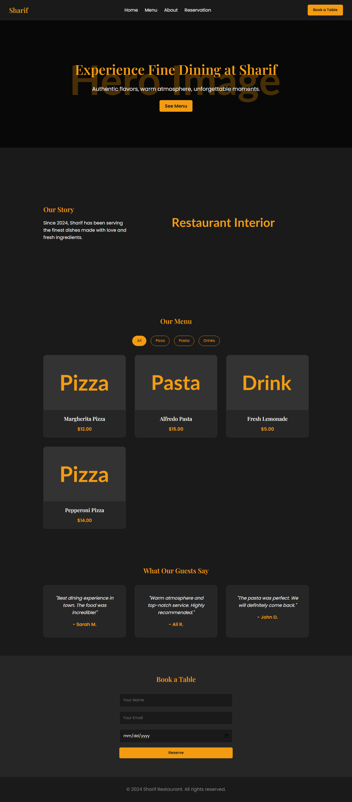

# 01 - Sharif Restaurant

## Project Overview
A responsive landing page for a fictional restaurant named "Sharif". 
Features a dark/gold theme inspired by the restaurant's exterior lighting.

## Features Built
- Sticky header with mobile hamburger menu
- Hero section with background image
- About section
- Dynamic menu section with filtering (All, Pizza, Pasta, Drinks)
- Testimonials section
- Reservation form with custom toast notification
- Smooth scroll & fade-in animations on scroll
- Back-to-top button

## What I Learned
- Using CSS Variables for theming and consistent colors
- Building responsive layouts with CSS Flexbox and Grid
- DOM manipulation and Event Delegation for the menu filter
- Using `IntersectionObserver` for scroll animations
- Handling form submission with `e.preventDefault()` and showing custom alerts (Toast)
- Managing mobile responsive design with media queries

## Result

