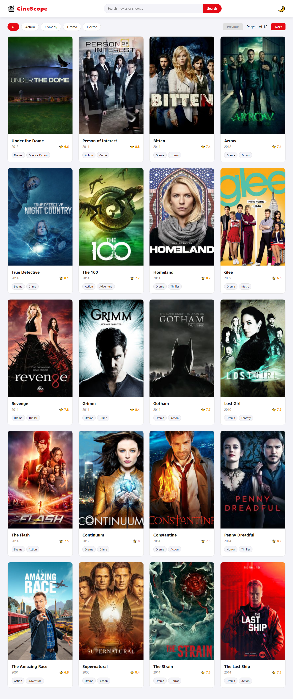

# 02 - CineScope (Movie & TV Show App)

## Project Overview
A dynamic movie and TV show application using the TVMaze API. 
Users can search for shows, filter by genre, browse pages, and view detailed information in a modern modal.

## Features Built
- Search functionality using a real API
- Client-side genre filtering (Action, Comedy, Drama, Horror)
- Client-side pagination (Next / Previous)
- Detailed modal with split-view design (image + info)
- Responsive layout with `aspect-ratio` to prevent image distortion
- Dark/Light mode with localStorage
- Loading state, error handling, and empty states
- Escape key and backdrop click to close modal

## What I Learned
- Fetching and handling data from an external API with `async/await`
- Managing complex application state (search results, pagination, active filters)
- Advanced CSS Grid and aspect-ratio for stable layouts
- Using `DOMParser` to safely strip HTML tags from API text
- Creating modern, accessible modals (preventing background scroll, keyboard events)
- Event Delegation for dynamic DOM elements

## Result

