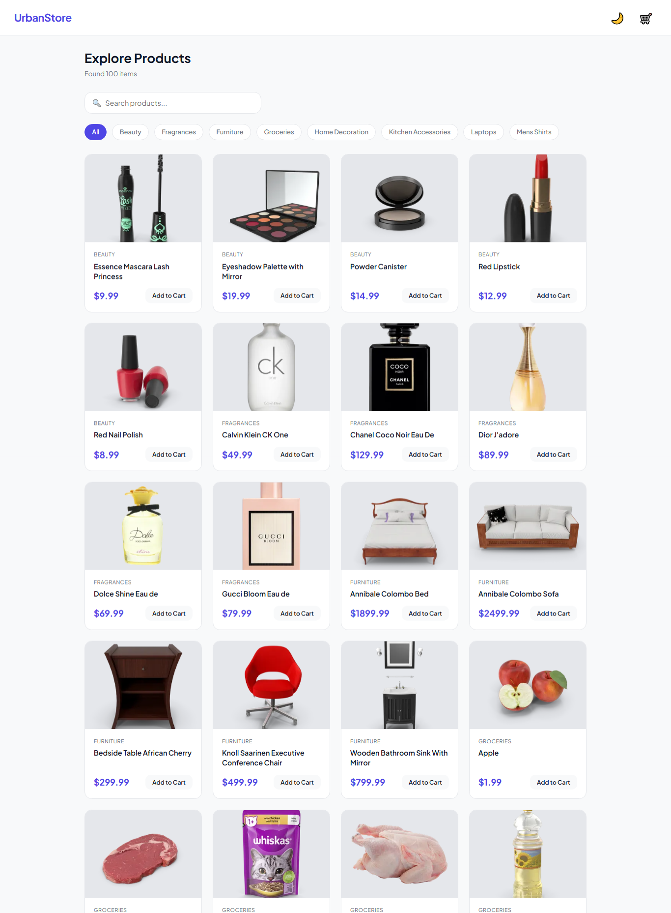

# 03 - React E-Commerce Shop (UrbanStore)

## Project Overview
A modern e-commerce storefront built with React and Vite.
It fetches real product data from the DummyJSON API and features category filtering, product search, and a fully functional shopping cart.

## Features Built
- Product grid with real API data (DummyJSON)
- Dynamic category filtering and live search
- Slide-out cart drawer
- Add / Remove / Update item quantities
- Automatic total price calculation
- Global state management with React Context API (Cart & Theme)
- Dark/Light mode with localStorage persistence
- Modern UI with Bento Grid layout and CSS Variables

## What I Learned
- Setting up a React project with Vite
- Component-based architecture (Header, Filters, CartDrawer)
- Fetching data from an external API in React (`useEffect`, `useState`)
- Using Context API to avoid prop drilling for global state
- Custom hooks (`useCart`, `useTheme`)
- Conditional rendering and list rendering with keys
- Handling complex UI states (loading, error, empty)

## Result

